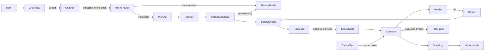

# SetupPal Finish Plan

This is the single implementation guide for finishing SetupPal. It replaces the old status docs (`AUDIT.md`, `CHANGES.md`, `DISCOVERY.md`, `FEEDBACK.md`), whose still-relevant content lives in [Appendix A](#appendix-a-history-and-known-limitations).

## How to use this doc

- Work the phases in order. Phase 0 unblocks everything else (nothing in Rust compiles on this machine yet). Phases 1 and 2 are P0 for a working demo.
- Each task has a stable ID (for example `P1.3`). Put the ID in your branch name, commit messages, and PR title. Ship one phase per PR (see [Conventions](#5-conventions-for-ai-developers)).
- Every task lists **Goal**, **Files**, **Steps**, and **Acceptance**. A task is only done when every acceptance bullet can be shown (command output, test name, or a short manual check note in the PR).
- File:line references were checked against the code at commit `f3a1c28`. Line numbers drift; when one no longer matches, search for the quoted symbol and keep going.
- Code snippets show the shape to build. They are not meant to be pasted as-is. Match the surrounding code style.
- Never put API key values anywhere: code, docs, tests, logs, commit messages, or PR text. See [Conventions](#5-conventions-for-ai-developers).

---

## 1. Final product decisions

These decisions are fixed. If a task seems to conflict with one, the decision wins. Ask before changing a decision.

| Topic | Decision |
|---|---|
| Shell | A real Tauri v2 app. The current runtime (Axum on port 3001, plus Vite on 5173, plus an Edge `--app` window) goes away. Remove [crates/gui/main-electron.cjs](crates/gui/main-electron.cjs), [crates/gui/preload.cjs](crates/gui/preload.cjs), and the Edge path in [crates/gui/launch-app.ps1](crates/gui/launch-app.ps1). |
| AI providers | Nebius Token Factory in production, NVIDIA NIM for testing. Each provider is pinned to one fixed model ID in a constant. No live model list and no model picker. Selection is `SETUPPAL_PROVIDER=nebius\|nim`. If unset, use Nebius when a Nebius key exists, otherwise NIM. |
| Mascot | Pixel only. Remove Mochi, Byte, and the pet selector. Pixel's speech bubbles stay ambiguous and fun and never quote the user's messages. This workspace rule overrides `ui.md` section 11.3. |
| Scope | SetupPal installs anything that passes two gates: (1) it installs unattended from the command line (winget silent, npm, pip, cargo, Modrinth or Fabric via its CLI installer, and similar) and can be verified with a CLI command, and (2) it passes the Safety Engine. Everything else gets a "Manual setup guide" reply: it says the app does not do non-terminal setup, gives step-by-step manual instructions, and lists similar things SetupPal *can* install. Apps that need a proprietary GUI launcher, store login, or DRM (Steam, Epic, Riot, Minecraft Bedrock, and similar) are always manual-only. |
| Docs | [AGENTS.md](AGENTS.md), [README.md](README.md), and [SECURITY.md](SECURITY.md) must state the same scope. SECURITY.md's repeated "Operational Boundary" blocks collapse into one section. (Those doc edits are tracked separately from this file.) |
| Chat output | Chat shows only real model output and real errors. No canned replies, no placeholder text, no reply cache. |
| Prompting | Prompts target a modest 30-40B model: plain, best-practice, easy to follow, with light flavor. Broad requests open with a short "what do you want set up?" question plus concrete suggestions. |

---

## 2. Current state snapshot

### 2.1 What is real today

| Area | Status | Where |
|---|---|---|
| Chat streaming | Real. `/api/chat/stream` forwards provider SSE deltas as `message.start`, `message.delta`, `message.end`, `message.error`. Retries transient errors before streaming starts; Stop aborts cleanly. | [main.rs](crates/gui/src-tauri/src/main.rs) `chat_stream_handler` (line 1133), `call_ai_chat_stream` (1260); [bridge.js](crates/gui/src/api/bridge.js) `runChatTurn` (315) |
| PC facts | Real. A scan runs each turn and facts are attached to the user turn. | `format_host_facts` (main.rs 670) |
| Plan and execute APIs | Real. `/api/plan` calls the planner (recipe first, then LLM with JSON Schema) and the Safety Engine. `/api/execute` runs the real `installer_core::Executor`. | `plan_handler` (1426), `execute_handler` (1482) |
| History and undo | Real. JSONL state log, rollback per transaction, HTML/Markdown export. Downloads view is derived from history. | `history_handler` (1544), `undo_handler` (1598); bridge.js `refreshHistory` (584) |
| Key testing | Real. `/api/test-key` (`test_provider_key_handler`, 503). | main.rs |
| Mascot animation registry | Real. 20 states in one registry with a checker script. | [animations.js](crates/gui/src/mascot/animations.js), [check-animations.js](crates/gui/scripts/check-animations.js) |
| Provider key redaction | Real. `CoreConfig` and `HttpTavilyVerifier` `Debug` output hides keys, covered by `debug_output_redacts_provider_keys` and `debug_output_redacts_api_key`. | [config.rs](crates/core/src/config.rs) lines 51-65 |
| Build and checks | Real (P0.1, P0.5). Rust builds with the `stable-x86_64-pc-windows-msvc` toolchain and VS Build Tools. `scripts/check.ps1` runs Rust tests, the frontend build, and the animation check, failing fast. `npm --prefix crates/gui run dev:all` starts the backend and Vite together. | [scripts/check.ps1](scripts/check.ps1), [package.json](crates/gui/package.json) |
| Git hygiene | Real (P0.3). `.orchestrator_state.jsonl`, Tauri `gen/`, and `src-tauri/target/` are ignored, and the state log is untracked. | [.gitignore](.gitignore) |

### 2.2 What is broken or missing

> **Status (Phase 7 complete):** every row below was fixed in Phases 0-7, except the items listed in [A.4](#a4-known-limitations-still-open). The table is kept as the record of what was wrong. Phase 7 also added: fonts bundled locally with a `'self'`-only CSP (`check:offline`), a project-folder picker for npm plans, a single-instance guard, `docs/E2E_CHECKLIST.md`, and `docs/DEMO.md`.

| Area | Problem | Evidence |
|---|---|---|
| Core UI loop | `store.activePlan` is never set from a real plan, so the plan card and task panel never appear. The `plan_generated` handler only plays a voice line and reads the wrong field (`payload.steps`; the event payload is `{ plan }`). Approve falls back to a hardcoded goal. | [bridge.js](crates/gui/src/api/bridge.js) lines 137-139 and 515 (`"Web and TypeScript development stack"`) |
| Chat to executor handoff | Neither chat handler ever returns a plan. The legacy `/api/chat` hardcodes `plan: None`; the streaming handler (the one the UI uses) has no plan or intent concept at all. | main.rs 1105-1113 (legacy), 1202-1243 (stream) |
| Success celebration | Confetti and "ALL APPROVED TASKS EXECUTED AND VERIFIED CLEANLY" run regardless of `overall_passed`. | bridge.js 531-552 |
| Stop and Esc | Both only reset the UI (`simulation.stopRun()`); nothing cancels a running plan. | [main.js](crates/gui/src/main.js) 104-108, [chat-view.js](crates/gui/src/components/chat-view.js) 367-370, [simulation.js](crates/gui/src/state/simulation.js) |
| Fake hashes | Hardcoded SHA-256 values that are the hash of an empty file (`e3b0c442...`) in **five** adapters, plus fake hashes in the Fabric recipe (`e3b0c442...` and well-known test-string digests). A step with any hash counts as "verified". | [winget.rs](crates/core/src/adapters/winget.rs) 31-56 and 70, [github.rs](crates/core/src/adapters/github.rs) 84-105 and 121, [npm.rs](crates/core/src/adapters/npm.rs) 91-105 and 121, [pypi.rs](crates/core/src/adapters/pypi.rs) 111-118 and 141, [modrinth.rs](crates/core/src/adapters/modrinth.rs) 104 and 137; [minecraft_fabric_1_21.yaml](recipes/minecraft_fabric_1_21.yaml) lines 29, 39, 49, 59; [safety/mod.rs](crates/core/src/safety/mod.rs) 366 |
| Download hash | `DownloadArtifact` ignores the step's `expected_sha256`; it only prints it into the receipt text. | [executor/mod.rs](crates/core/src/executor/mod.rs) 513-589 |
| venv | `CreateIsolatedEnv` only runs `create_dir_all`, and `ExecutionContext.isolated_env` is always `None`, so pip installs never go into the venv. | executor/mod.rs 275-279 and 591-594 |
| Vendor adapter | `AdapterKind::OfficialVendorUrl` has no adapter; the Fabric recipe step that uses it fails. | [adapters/mod.rs](crates/core/src/adapters/mod.rs) 150-158 |
| GitHub install | `GitHubReleasesAdapter::install` only reports success; it never runs anything. | github.rs 342-377 |
| Green approval | The Green gate emits `StepApprovalRequired` and then runs the step anyway. The UI always sends `auto_approve_green: true`. | executor/mod.rs 208-216; bridge.js 523 |
| Yellow approval | `allow_yellow` is one boolean for the whole plan. There is no per-step approval. | executor/mod.rs 174-205; main.rs 1477 |
| OSV | Transport errors fail closed (Yellow), but a non-2xx HTTP response returns an empty list, which fails open. OSV only covers PyPI and npm. | [osv.rs](crates/core/src/safety/osv.rs) 97-103 and 127-129; safety/mod.rs 350-354 |
| Verifier | `verify_step` reports every `InstallPackage` as passed. The executor does not run any verification after a package install. | [verifier/mod.rs](crates/core/src/verifier/mod.rs) 45-51; executor/mod.rs 338-345 |
| Step errors | Adapter errors use `?` and abort the whole request with HTTP 500 instead of producing a failed step result and a `StepExecutionFailed` event (the event exists but is never emitted). | executor/mod.rs 295-303; [events.rs](crates/core/src/events.rs) 63-66 |
| Healer | `Healer` is exported but never constructed by the GUI or CLI. | [healer/mod.rs](crates/core/src/healer/mod.rs); [lib.rs](crates/core/src/lib.rs) 28 |
| Recipes | `web_fullstack_ts.yaml` **and** `rust_dev.yaml` are not embedded. The cpp20 recipe hardcodes the LLVM path and its summary promises Ninja and Git, which it does not install. | [recipes/mod.rs](crates/core/src/recipes/mod.rs) 105-110; [cpp20_dev.yaml](recipes/cpp20_dev.yaml) 8 and 33 |
| npm target dir | `npm install` runs in the backend's current directory. `OsProvider::run_command` has no working-directory parameter. | npm.rs 338-348; [os/mod.rs](crates/core/src/os/mod.rs) 43-48 |
| Local API security | No authentication. CORS allows any origin. Fixed port 3001. `csp` is `null`. | main.rs 80-83 and 102-110; [tauri.conf.json](crates/gui/src-tauri/tauri.conf.json) 23-25 |
| Keys | The NVIDIA key is kept in `localStorage` and sent in every chat request. The Tavily and GitHub values saved in Accounts are stored in `localStorage` and never reach the backend. The client can also override `model` (and `endpoint` on the legacy route). | [client.js](crates/gui/src/api/client.js) 50, 86, 107; [accounts-view.js](crates/gui/src/components/accounts-view.js) 11-47 and 124; main.rs 372-410 |
| Leaked keys | Real NVIDIA- and Tavily-shaped key values exist in the git history of `.env.example`. Blanking the file does not remove them. Both keys must be rotated. | See Appendix A |
| Tests | Coverage is thin: core runs only the two key-redaction tests (moved to module scope in P0.2), and the GUI runs the three `provider_selection_tests` in main.rs, which become obsolete with explicit provider selection. | [config.rs](crates/core/src/config.rs), [tavily.rs](crates/core/src/safety/tavily.rs), main.rs `provider_selection_tests` |
| Tauri | `src-tauri/Cargo.toml` has no `tauri` dependency, there is no `build.rs`, no `icons/`, and no `capabilities/`. The binary is a plain Axum server. | [src-tauri/Cargo.toml](crates/gui/src-tauri/Cargo.toml) |
| Dead code and wrong fields | Unused: `test_key_handler` (main.rs 426), `formatStepDetails` (bridge.js 13), `getRecipes` (client.js 41), `sendChat` (client.js 85, and with it the legacy `/api/chat` route, `ai_cache`, and its `PlanningStarted` emit at main.rs 1087). Wrong field names: `detected_tools` (bridge.js 124; real field is `installed_tools`) and `payload.steps` (bridge.js 138; real path is `payload.plan.steps`). | as listed |
| HTML injection | Terminal log lines, plan rows, and Why reasons are interpolated into `innerHTML` without escaping. | chat-view.js 119-146 and 251-253; [task-panel.js](crates/gui/src/components/task-panel.js) 82-84 |
| Settings | The safety level control only changes a label (the backend hardcodes `"safety_level": "strict"`). `modelPlanner` is a stale label. | [settings-view.js](crates/gui/src/components/settings-view.js) 187; [store.js](crates/gui/src/state/store.js) 134 and 142; main.rs 152 |
---

## 3. Target architecture



How chat hands off to planning:

1. The system prompt tells the model to end a converged reply with one fenced `setuppal-intent` JSON block.
2. The streaming handler holds that block back from the visible text, validates it, and emits a `message.intent` SSE event before `message.end`. The `reply` in `message.end` has the block removed.
3. On `kind: "install"`, the frontend calls `/api/plan` with the goal and a short conversation summary and sets `store.activePlan` from the response. On `kind: "manual"`, it renders a Manual setup guide card.
4. Each plan step keeps its `step_id`. SSE step events from `/api/events` update the matching task in place.
5. Approve sends the server-side `plan_id` plus explicit per-step approvals. The server never trusts a client-supplied plan.

Runtime (after Phase 5): one Tauri process. It starts Axum on `127.0.0.1:<random port>`, generates a per-launch bearer token, and hands both to the webview through a Tauri command. Every `/api/*` request, including SSE, carries the token.

---

## 4. Phased task list

### Phase 0 - Foundations (do first)

#### P0.1 Install the MSVC build tools

- **Goal:** `cargo check --workspace` and `cargo test --workspace` work on Windows.
- **Files:** none in the repo; add a "Prerequisites" note to [README.md](README.md) only if another agent is not already editing it (coordinate).
- **Steps:**
  1. Install the Visual C++ build tools unattended:
     ```powershell
     winget install --id Microsoft.VisualStudio.2022.BuildTools --exact --silent --accept-package-agreements --accept-source-agreements --override "--quiet --wait --norestart --add Microsoft.VisualStudio.Workload.VCTools --includeRecommended"
     ```
  2. Open a new terminal (so PATH refreshes) and confirm `rustup default` is `stable-x86_64-pc-windows-msvc`.
- **Acceptance:**
  - `cargo check --workspace` exits 0.
  - `cargo test --workspace` runs (it may fail tests; it must compile).

#### P0.2 Fix the misplaced test modules

- **Goal:** core unit tests compile and run.
- **Files:** [crates/core/src/config.rs](crates/core/src/config.rs), [crates/core/src/safety/tavily.rs](crates/core/src/safety/tavily.rs)
- **Steps:**
  1. In `config.rs`, cut the `#[cfg(test)] mod tests { ... }` block (lines 148-173, inside the `for raw_line in contents.lines()` loop that starts at 135) and paste it at file end, at module scope.
  2. Do the same in `tavily.rs` (block at 163, inside the `for item in &data.results` loop at 148).
  3. Fix any imports the moved tests now need (`use super::*;` plus whatever the tests reference).
- **Acceptance:**
  - `cargo test -p installer_core` lists `debug_output_redacts_provider_keys` and the Tavily test as passing.
  - Neither file has `#[cfg(test)]` anywhere other than at module scope.

#### P0.3 Git hygiene

- **Goal:** runtime state never gets committed.
- **Files:** [.gitignore](.gitignore)
- **Steps:**
  1. Add `.orchestrator_state.jsonl` and `*.orchestrator_state.jsonl`.
  2. `dist/` is already present and covers `crates/gui/dist`; leave it. Add `crates/gui/src-tauri/gen/` (Tauri generated schemas) and `crates/gui/src-tauri/target/`.
  3. Run `git rm --cached .orchestrator_state.jsonl` if it is tracked.
- **Acceptance:** `git status` stays clean after running a plan end to end.

#### P0.4 Rotate the leaked keys

- **Goal:** the NVIDIA and Tavily keys that appear in `.env.example` history are dead.
- **Files:** none in the repo. This is a human task; an AI agent must ask the user to do it and must not read `.env` or print keys.
- **Steps:**
  1. Revoke the NVIDIA key at build.nvidia.com and the Tavily key in the Tavily dashboard; issue new ones.
  2. Put the new values only in the local, ignored `.env` (and later the OS keychain, P5.4).
  3. Optional: run `gitleaks detect` for a full report; history rewriting is optional once keys are revoked.
- **Acceptance:** the user confirms both old keys are revoked. Record "keys rotated on <date>" in the PR, never the values.

#### P0.5 One-command dev and check scripts

- **Goal:** one command starts the dev app and one command runs all checks.
- **Files:** [crates/gui/package.json](crates/gui/package.json), new `scripts/check.ps1`, [start-app.bat](start-app.bat)
- **Steps:**
  1. Until Phase 5 lands, `npm --prefix crates/gui run dev:all` starts `cargo run -p installer_gui` and `vite` together (use the existing `launch-app.ps1` logic minus the Edge window, or the `concurrently` dev dependency).
  2. `scripts/check.ps1` runs, in order and failing fast: `cargo test --workspace`, `npm --prefix crates/gui run build`, `npm --prefix crates/gui run check:animations`.
  3. Fix [check-animations.js](crates/gui/scripts/check-animations.js) lines 42-45: the sidebar no longer shows an animation count (the Mascot Lab lives in Settings). Check only `animation-lab.js` (and `settings-view.js` if it shows a count) for `ANIMATIONS.length`.
- **Acceptance:**
  - `powershell -File scripts/check.ps1` exits 0 on a clean tree.
  - `npm --prefix crates/gui run check:animations` passes.

---

### Phase 1 - Core loop (P0)

#### P1.1 The `setuppal-intent` block

- **Goal:** chat produces a machine-readable intent when the conversation has converged, without showing it to the user.
- **Files:** [crates/gui/src-tauri/src/main.rs](crates/gui/src-tauri/src/main.rs) (new module `intent.rs` next to it), [crates/gui/src/api/client.js](crates/gui/src/api/client.js), [crates/gui/src/api/bridge.js](crates/gui/src/api/bridge.js)
- **Schema.** Exactly one fenced block at the very end of a reply, language tag `setuppal-intent`:

  ````text
  ```setuppal-intent
  {"kind":"install","goal":"Python 3.12 with a venv for data science","items":[{"name":"Python 3.12","ecosystem":"winget","id":"Python.Python.3.12"},{"name":"pandas","ecosystem":"pypi","id":"pandas"}]}
  ```
  ````

  ```json
  {
    "$schema": "https://json-schema.org/draft/2020-12/schema",
    "title": "SetupPalIntent",
    "oneOf": [
      {
        "type": "object",
        "additionalProperties": false,
        "required": ["kind", "goal"],
        "properties": {
          "kind": { "const": "install" },
          "goal": { "type": "string", "minLength": 3, "maxLength": 300 },
          "items": {
            "type": "array",
            "maxItems": 20,
            "items": {
              "type": "object",
              "additionalProperties": false,
              "required": ["name"],
              "properties": {
                "name": { "type": "string", "maxLength": 80 },
                "ecosystem": { "enum": ["winget", "npm", "pypi", "cargo", "modrinth", "github", "vendor"] },
                "id": { "type": "string", "maxLength": 120 },
                "version": { "type": "string", "maxLength": 40 }
              }
            }
          }
        }
      },
      {
        "type": "object",
        "additionalProperties": false,
        "required": ["kind", "item", "reason"],
        "properties": {
          "kind": { "const": "manual" },
          "item": { "type": "string", "maxLength": 80 },
          "reason": { "type": "string", "maxLength": 300 },
          "alternatives": { "type": "array", "maxItems": 5, "items": { "type": "string", "maxLength": 80 } }
        }
      }
    ]
  }
  ```

  Rust shape (serde, `deny_unknown_fields`):

  ```rust
  #[derive(Debug, Clone, Serialize, Deserialize)]
  #[serde(tag = "kind", rename_all = "snake_case", deny_unknown_fields)]
  pub enum SetupIntent {
      Install { goal: String, #[serde(default)] items: Vec<IntentItem> },
      Manual { item: String, reason: String, #[serde(default)] alternatives: Vec<String> },
  }
  ```

- **Steps:**
  1. In `call_ai_chat_stream` (main.rs 1260), wrap delta forwarding in a small state machine. Forward text normally; when the accumulated text contains the start of a fence line (```` ``` ```` at line start), hold back the tail until you know whether it is ```` ```setuppal-intent ````. Once the intent fence opens, stop forwarding and capture until the closing fence.
  2. After `[DONE]`, parse the captured JSON with `serde_json::from_str::<SetupIntent>`, then validate lengths. Items are hints only; the planner still decides real steps.
  3. Emit `message.intent` with `{ "intent": <SetupIntent> }` before `message.end`. The `reply` in `message.end` must not contain the block.
  4. If parsing fails, still strip the block, emit no intent, and log `warn!` with the error kind only (no content). Do not invent a fallback intent.
  5. In bridge.js `runChatTurn`, handle `event.type === 'message.intent'` and store it on the assistant message (`intent` field). After `message.end`, call `this.handleIntent(conversationId, intent, history)`.
- **Acceptance:**
  - Rust unit tests for the splitter: block at end, block split across chunk boundaries (including a split inside the fence marker), malformed JSON, no block, and a normal code block (` ```powershell `) that must pass through untouched.
  - In the running app, a converged install conversation shows no JSON in the bubble, and the dev console shows one `message.intent`.

#### P1.2 Intent router and `/api/plan` wiring

- **Goal:** an install intent produces a real plan card; a manual intent produces a Manual setup guide card.
- **Files:** bridge.js, client.js, main.rs (`PlanRequest`, `plan_handler` at 1420-1469), [store.js](crates/gui/src/state/store.js)
- **Steps:**
  1. Extend `PlanRequest` with `context: Option<String>` (max 1,500 chars, the conversation summary). Do **not** pass the summary as `untrusted_readme`: a non-empty `untrusted_context` skips recipe matching ([planner/mod.rs](crates/core/src/planner/mod.rs) 43). Pass `context` to the LLM prompt only.
  2. Store plans server-side in `AppState.plans: Arc<RwLock<HashMap<String, (Plan, PlanSafetyReport)>>>` keyed by `plan_id` (replace the single `current_plan` slot at main.rs 41). Make each `plan_id` unique (`plan-recipe-<id>-<uuid8>`).
  3. Remove the duplicate `PlanningStarted` and `PlanGenerated` emits in `plan_handler` (1437 and 1452); the planner already emits them.
  4. Map the response to the UI shape in one function, `toActivePlan(data)`, in bridge.js:
     ```js
     // activePlan shape consumed by chat-view.js renderPlanCard and task-panel.js
     {
       planId, title: plan.goal, subtitle: plan.summary, status: 'ready', // ready | running | completed | failed | cancelled
       tasks: plan.steps.map((s, i) => ({
         id: s.id, num: i + 1, title: s.description,
         sourceDomain: meta.source_domain, sourceUrl: meta.source_url,
         verdict: report.rating.toUpperCase(),          // GREEN | YELLOW | RED
         verdictTitle: meta.verdict_title, verdictDesc: meta.verdict_desc,
         reasons: report.reasons, status: 'waiting',    // waiting | running | done | held | blocked | failed | skipped
         approved: report.rating === 'green',
       })),
     }
     ```
  5. `store.setState` the `activePlan` on the conversation that produced the intent (use the existing per-conversation persistence in store.js).
  6. Fix the `plan_generated` handler (bridge.js 137) to read `payload.plan.steps.length`, and `scan_completed` (124) to read `installed_tools`.
- **Acceptance:**
  - Asking "set me up for Rust" yields a plan card with the real recipe steps, each with a verdict badge and source.
  - Reloading the window restores the same plan card for that conversation.
  - `grep "Web and TypeScript development stack"` finds nothing.

#### P1.3 Plan card shows real steps

- **Goal:** the plan card is readable and honest.
- **Files:** [chat-view.js](crates/gui/src/components/chat-view.js) `renderPlanCard` (112-168), [task-panel.js](crates/gui/src/components/task-panel.js)
- **Steps:**
  1. Render each step: number, description, source domain (as a link only when `sourceUrl` is `https:`), verdict badge, and a Why? disclosure with all reasons.
  2. Red steps show "Blocked" and no approve control. Yellow steps show an "Approve this step" checkbox, unchecked by default. Green steps are pre-checked (unless the user turned off auto-approve, P2.6).
  3. Escape every interpolated value (shared `esc()` helper, see P6.6).
  4. Remove the unused `formatStepDetails` (bridge.js 13-59); the server's `step_metadata` is the single source for display strings.
- **Acceptance:** for a plan with one Yellow step, the card shows the Yellow reason text from the Safety Engine, and the approve button label reflects the count ("Run 4 approved steps").

#### P1.4 Per-step approval

- **Goal:** the user approves Yellow steps one at a time; the server enforces it.
- **Files:** main.rs `ExecuteRequest` (1471-1480) and `execute_handler`; [executor/mod.rs](crates/core/src/executor/mod.rs) `ExecutionOptions` (31-50) and the gates (145-216); client.js `executePlan` (174-192); bridge.js `approveAndRunPlan` (504)
- **Request body** (`POST /api/execute`):
  ```json
  {
    "run_id": "c0b7b1e2-1b7e-4a0b-9a37-8d1f0f2a6c11",
    "plan_id": "plan-recipe-rust_dev-3f9a1c2b",
    "dry_run": false,
    "approved_step_ids": ["step-1", "step-2"],
    "allow_yellow_steps": ["step-3"],
    "start_at_step_id": null,
    "project_dir": "C:\\Users\\me\\code\\my-app",
    "trusted_categories": ["verified_winget"]
  }
  ```
- **Steps:**
  1. Drop `custom_plan` and the boolean `allow_yellow` from `ExecuteRequest`. Look the plan up by `plan_id` (404 if missing). Re-run `evaluate_plan` right before execution so verdicts are fresh.
  2. Replace `ExecutionOptions.allow_yellow: bool` with `approved_step_ids: HashSet<String>` and `allow_yellow_steps: HashSet<String>`, and add `cancel: CancellationToken` (P1.5).
  3. Gate rules, in order:
     - Red: never runs. Emit `StepExecutionBlocked`, stop.
     - Yellow: runs only if its ID is in `allow_yellow_steps`. Otherwise emit `StepApprovalRequired` and stop with `halted_at_step_id`.
     - Green: runs if `auto_approve_green` (the user setting, P2.6), or its ID is in `approved_step_ids`, or it is in a trusted category. Otherwise emit `StepApprovalRequired` and stop.
  4. `start_at_step_id` lets the UI continue after approving a held step; earlier steps are skipped (already recorded).
  5. Add `halted_at_step_id: Option<String>` and per-step `status` (`done | failed | blocked | held | skipped | cancelled`) to `PlanExecutionSummary`.
  6. UI: when a held step comes back, show "Approve and continue" on that row; clicking it re-calls execute with that ID added and `start_at_step_id` set.
- **Acceptance:**
  - Executor unit tests: Yellow not in list halts; Yellow in list runs; Green without approval and without auto-approve halts; Red never runs even if listed in both sets.
  - A request with a `plan_id` the server never issued returns 404.

#### P1.5 Cancel execution

- **Goal:** Stop and Esc really stop a running plan.
- **Files:** main.rs (new route), executor/mod.rs, [os/mod.rs](crates/core/src/os/mod.rs) `run_command` (142-176), [main.js](crates/gui/src/main.js) 104-108, chat-view.js 367-370, client.js, bridge.js
- **API:** `POST /api/execute/cancel` with `{ "run_id": "<uuid>" }`. Returns `{ "status": "cancelling" }` or 404 when the run is unknown or finished.
- **Steps:**
  1. Add `tokio-util` and keep `AppState.runs: Arc<Mutex<HashMap<String, CancellationToken>>>`. `execute_handler` inserts the client-generated `run_id` (`crypto.randomUUID()`) and removes it when done.
  2. Executor checks `options.cancel.is_cancelled()` before each step. Add a `run_command_cancellable(binary, args, extra_path, cwd, cancel)` to `OsProvider` that sets `kill_on_drop(true)` and `select!`s on `cancel.cancelled()`. (Today `run_command` has a 5-minute timeout but no kill, and no working directory.)
  3. A cancelled step records status `cancelled`, emits the new `ExecutionCancelled { run_id, step_id }` event, and the plan stops. Completed steps stay in history so undo works.
  4. Frontend: Esc and the Stop button call `bridge.cancelRun()` when a run is active, else `bridge.stopChat()`. Delete `simulation.js` once nothing imports it.
- **Acceptance:** start a plan with a slow step (for example a winget install), press Esc: within 2 seconds the task shows `cancelled`, the child process is gone (`Get-Process winget` is empty), and History shows only the steps that finished.

#### P1.6 Honest completion

- **Goal:** celebrate only real success.
- **Files:** bridge.js `approveAndRunPlan` (527-560)
- **Steps:**
  1. After `executePlan` returns, branch on `summary.overall_passed`, `summary.halted_at_step_id`, and cancellation.
  2. Passed: confetti, `task.all_done` sound, Pixel `completed`. Halted: no confetti, the plan card stays open on the held row. Failed: error sound, Pixel `error`, and a chat message with the failing step's real `stderr` (trimmed to 600 chars, escaped).
  3. Handle `step_execution_failed` and `execution_cancelled` events in `handleAgentEvent`; the `verification_completed` handler (264) must print pass or fail from `payload.result.passed`, not always a check mark.
- **Acceptance:** a plan with a forced failing verify step shows no confetti, marks the step `failed`, and the terminal log shows the real stderr.

#### P1.7 Healer, one retry

- **Goal:** on a step failure, try one safe remediation automatically.
- **Files:** main.rs `execute_handler`, [healer/mod.rs](crates/core/src/healer/mod.rs), executor/mod.rs, bridge.js
- **Steps:**
  1. Make adapter errors produce a failed `StepExecutionResult` (with stderr) plus `StepExecutionFailed`, instead of `?` aborting the request (executor/mod.rs 295-303 and 527-535).
  2. In `execute_handler`, when the summary has a failed step and the run was not cancelled, build `FailureContext` and call `Healer::with_max_attempts(1).diagnose_and_propose`.
  3. The remediation plan goes through `SafetyEngine` (already done inside the healer). Store it as a new server plan. If it has any Yellow step, do not auto-run it: return it as `remediation` so the UI shows a second plan card. If it is all Green and auto-approve is on, run it once.
  4. Handle `self_heal_triggered` and `self_heal_plan_proposed` events in the UI (Pixel `diagnosing`, a terminal log line).
- **Acceptance:** with a mock `LlmClient` that returns a fixed remediation plan, a failing step triggers exactly one remediation; a Red remediation is never executed; a second failure does not trigger another attempt.

---

### Phase 2 - Engine correctness

#### P2.1 Enforce plan hashes

- **Goal:** a downloaded file is accepted only if it matches the hash in the plan step.
- **Files:** executor/mod.rs `Step::DownloadArtifact` (513-589), the `fetch_artifact` implementations in each adapter
- **Steps:**
  1. Before `fetch_artifact`, set `metadata.expected_sha256 = Some(step.expected_sha256.clone())` when the step has one; the step value wins over adapter metadata.
  2. After the download, call `hash::verify_file_sha256(destination, expected)`. On mismatch, delete the file, fail the step with `AdapterError::HashMismatch`, and do not record a download transaction.
  3. Verification result is `passed` only when the hash matched.
- **Acceptance:** unit test with a temp file: correct hash passes; wrong hash fails and the file no longer exists.

#### P2.2 Remove every fake hash

- **Goal:** no hardcoded or placeholder digests anywhere.
- **Files:** winget.rs, github.rs, npm.rs, pypi.rs, modrinth.rs (fallback metadata tables; see the snapshot table for lines), [minecraft_fabric_1_21.yaml](recipes/minecraft_fabric_1_21.yaml), [types.rs](crates/core/src/types.rs) 45-51, safety/mod.rs 366 and 461-467
- **Steps:**
  1. Delete the hardcoded fallback tables that return `e3b0c442...`. When live metadata is unavailable, return `expected_sha256: None`.
  2. Make `Step::DownloadArtifact.expected_sha256` an `Option<String>`. Recipes either carry a real upstream digest or omit it.
  3. Reject the empty-file digest outright in `policy::is_valid_sha256_hex`.
  4. Safety Engine: `sha256_verified` is `Some(true)` only when a real digest came from the upstream registry API (Modrinth `hashes.sha256`, PyPI `digests.sha256`, GitHub release asset digest), never because a field is `Some`. A step without a digest gets the reason "No upstream checksum available" and at least Yellow (score 40 already maps to Yellow).
- **Acceptance:**
  - `rg -n "e3b0c44298fc1c149afbf4c8996fb92427ae41e4649b934ca495991b7852b855|2c26b46b68ffc68ff99b453c1d30413413422d706483bfa0f98a5e886266e7ae|8f434346648f6b96df89dda901c5176b10a6d83961dd3c1ac88b59b2dc327aa4" crates recipes` finds nothing (only a test asserting rejection is allowed).
  - A plan step with no hash renders Yellow with the checksum reason.

#### P2.3 Real venv creation

- **Goal:** Python recipes install into an isolated venv.
- **Files:** executor/mod.rs `CreateIsolatedEnv` (591-639) and `ExecutionContext` construction (275-279); [pypi.rs](crates/core/src/adapters/pypi.rs) (already honors `ctx.isolated_env` at 188)
- **Steps:**
  1. For `IsolationKind::PythonVenv`, run `python -m venv <path>` with `run_command` (resolve `python` through `which_in_paths`; never through a shell).
  2. Keep `current_isolated_env: Option<PathBuf>` across steps in `execute_plan`, and pass it in each step's `ExecutionContext`.
  3. In pypi.rs, use `<venv>\Scripts\python.exe -m pip install` when `isolated_env` is set.
  4. Verify the step with `<venv>\Scripts\python.exe --version`. Rollback removes the directory (already `RollbackData::IsolatedEnv`).
- **Acceptance:** running `python_ai_venv` creates `<path>\Scripts\python.exe`, and `pip show numpy` run with the venv's pip succeeds while the global one does not.

#### P2.4 `OfficialVendorUrl` adapter and Fabric CLI install

- **Goal:** vendor downloads from allowlisted domains work, including the Fabric installer.
- **Files:** new `crates/core/src/adapters/vendor.rs`, [adapters/mod.rs](crates/core/src/adapters/mod.rs) 150-158, [safety/policy.rs](crates/core/src/safety/policy.rs), [minecraft_fabric_1_21.yaml](recipes/minecraft_fabric_1_21.yaml)
- **Steps:**
  1. `VendorUrlAdapter` resolves an `https` URL, refuses any host not in the policy allowlist (add `maven.fabricmc.net` and `meta.fabricmc.net`), downloads with a size cap, and enforces the step hash (P2.1).
  2. Fabric: fetch the installer version from `https://meta.fabricmc.net/v2/versions/installer`, download the JAR, and run it headless: `java -jar fabric-installer.jar client -mcversion 1.21 -dir "%APPDATA%\.minecraft" -noprofile` (check the flags against the installer's `help` output). Add a typed step for it (for example `Step::RunVendorInstaller { kind: VendorInstaller::FabricClient, mc_version }`) rather than generic arguments, so the LLM cannot invent commands.
  3. Register the adapter in `with_system_defaults`.
- **Acceptance:** the Fabric recipe runs end to end on a machine with Java and an existing Minecraft Java install; the `fabric-loader-*` version folder appears; rollback removes the downloaded files.

#### P2.5 GitHub releases: install for real or map to winget

- **Goal:** no step claims an install it did not do.
- **Files:** github.rs 342-377
- **Steps:**
  1. If the release asset is an `.msi`, run `msiexec /i <file> /qn /norestart` (user scope where supported). If it is an installer EXE with known silent flags, use a small per-project table of flags. If it is a zip or portable binary, extract it to `%LOCALAPPDATA%\SetupPal\tools\<name>` and add that directory to the user PATH as a follow-up step.
  2. If the project has a winget ID, prefer winget and say so in the plan.
  3. Otherwise return `AdapterError::Other("no unattended install path")`, which the installability gate (P3.1) turns into a manual guide.
- **Acceptance:** `install` never returns success without having run or extracted something; unit test for the "no path" branch.

#### P2.6 Real verification and explicit Green approval

- **Goal:** "passed" means the tool actually works.
- **Files:** verifier/mod.rs 45-51, executor/mod.rs 208-216 and 338-345, [store.js](crates/gui/src/state/store.js) settings, settings-view.js
- **Steps:**
  1. `InstallPackage` verification by ecosystem: winget uses `winget list --id <id> --exact` (exit 0 and the ID in output); pip uses `<python> -m pip show <pkg>`; npm uses `npm ls <pkg> --depth=0` in the project directory; cargo uses `cargo install --list`. Then run the binary's version command when a matching `AllowedBinary` exists.
  2. The executor calls the verifier after every install and stores the result in `StepExecutionResult.verification`.
  3. Green approval: remove the "emit event and run anyway" path (208-216). Add an "Auto-approve safe steps" setting (default off) that maps to `auto_approve_green`.
- **Acceptance:** a winget install whose package is not present afterwards fails verification; with auto-approve off, a Green-only plan halts until approved.

#### P2.7 OSV fails closed

- **Goal:** an OSV outage never silently passes a package.
- **Files:** [osv.rs](crates/core/src/safety/osv.rs) 127-129
- **Steps:**
  1. Return `Err(CoreError::Llm(..))` (or a new `CoreError::Verification`) on any non-2xx status. The existing handler at safety/mod.rs 350-354 already turns errors into Yellow.
  2. Keep winget, cargo, and vendor sources as "not covered by OSV" with an explicit reason, not a silent pass.
- **Acceptance:** unit test with a mock `OsvClient` returning an error yields Yellow and the reason "Verification service (OSV.dev) unavailable".

#### P2.8 Recipes

- **Goal:** every recipe in `recipes/` is embedded and correct.
- **Files:** [recipes/mod.rs](crates/core/src/recipes/mod.rs) 105-110, [cpp20_dev.yaml](recipes/cpp20_dev.yaml)
- **Steps:**
  1. Embed `web_fullstack_ts.yaml` and `rust_dev.yaml` alongside the existing three.
  2. cpp20: add `Ninja-build.Ninja` and `Git.Git` winget steps. Replace the hardcoded `C:\Program Files\LLVM\bin` PATH step with discovery: after install, find `clang++.exe` under the winget install location or `HKLM\SOFTWARE\LLVM\LLVM`, and add that directory. Model it as a typed step (for example `Step::AddDiscoveredToolToPath { binary: AllowedBinary::Clang }`).
  3. Add a test that every file in `recipes/` parses and appears in `embedded_recipes()`.
- **Acceptance:** `cargo test -p installer_core recipes` passes and the recipe count test equals the number of YAML files.

#### P2.9 npm project directory

- **Goal:** `npm install` targets the folder the user chose.
- **Files:** npm.rs 304-360, os/mod.rs `run_command`, main.rs `ExecuteRequest.project_dir`, the plan card
- **Steps:**
  1. Add a `cwd: Option<&Path>` to the command runner (shared with P1.5).
  2. Plans with npm steps show a "Project folder" picker (Tauri dialog plugin after Phase 5; a text field before). Send it as `project_dir`. Reject paths outside the user profile and require the folder to exist.
- **Acceptance:** the package appears in `<project_dir>\node_modules` and not in the backend's working directory.

---

### Phase 3 - Broadened scope and installability gate

#### P3.1 `Installability` check in core

- **Goal:** a deterministic answer to "can SetupPal install this unattended?".
- **Files:** new `crates/core/src/installability.rs`, export from [lib.rs](crates/core/src/lib.rs); call from `plan_handler`
- **Shape:**
  ```rust
  #[derive(Debug, Clone, Serialize, Deserialize, PartialEq, Eq)]
  #[serde(tag = "result", rename_all = "snake_case")]
  pub enum Installability {
      CliInstallable,
      NeedsAdmin { reason: String },
      ManualOnly { reason: ManualReason, detail: String },
  }

  #[derive(Debug, Clone, Copy, Serialize, Deserialize, PartialEq, Eq)]
  #[serde(rename_all = "snake_case")]
  pub enum ManualReason { LauncherOrDrm, StoreOnly, NoSilentInstaller, InteractiveLogin, Unknown }

  pub async fn check(step: &Step, os: &dyn OsProvider) -> Installability;
  ```
- **Steps:**
  1. Known launcher or DRM list (winget IDs and name keywords): `Valve.Steam`, `EpicGames.EpicGamesLauncher`, `RiotGames.*`, `ElectronicArts.EADesktop`, `Ubisoft.Connect`, `Mojang.MinecraftLauncher`, Minecraft Bedrock, Roblox, Battle.net. These are always `ManualOnly(LauncherOrDrm)`. Reuse and then delete the keyword list in `format_host_facts` (main.rs 716-722).
  2. winget signals: run `winget show --id <id> --exact --accept-source-agreements` and read `Installer Type` and `Installer Scope`. `msstore` source means `StoreOnly`. `msi`, `msix`, `wix`, `inno`, `nullsoft`, `burn`, `portable`, `zip` are silent-capable. `exe` without known silent switches means `NoSilentInstaller`. Machine-only scope means `NeedsAdmin`. If the output cannot be parsed, return `CliInstallable` but add a Yellow reason "installer type unknown".
  3. npm, PyPI, cargo, and Modrinth packages are `CliInstallable`.
  4. In `plan_handler`, run the check per step. If any step is `ManualOnly`, respond `{ "kind": "manual", "item": ..., "reason": ..., "alternatives": [...] }` instead of a plan. `NeedsAdmin` steps become Yellow with the reason text that already maps to "Administrator access needed" (safety/mod.rs 74-84).
- **Acceptance:** unit tests with a mock `OsProvider` returning canned `winget show` output for each installer type; `Valve.Steam` is always `ManualOnly`.

#### P3.2 Manual setup guide reply and card

- **Goal:** out-of-scope requests get a useful, honest answer.
- **Files:** chat-view.js / [chat-message.js](crates/gui/src/components/chat-message.js), bridge.js `handleIntent`, styles in [components.css](crates/gui/src/styles/components.css)
- **Steps:**
  1. A manual intent (from chat or from `/api/plan`) renders a card titled "Manual setup guide" with: one line that SetupPal only does terminal-based, unattended setup; the model's numbered steps (already in the visible reply); and up to five "SetupPal can install instead" chips that submit a new goal.
  2. No plan card and no approve button for manual intents.
- **Acceptance:** "install Steam" shows the manual card with alternatives and never calls `/api/execute`.

#### P3.3 Prompt rewrite for the new scope

- **Goal:** the model knows the broadened scope and the intent contract.
- **Files:** main.rs `STATIC_SYSTEM_PROMPT` (640-653), `format_host_facts` (670-726), `PROMPT_VERSION` (638)
- **Steps:**
  1. Scope paragraph: anything installable unattended from the command line and checkable with a CLI command; launcher, store, DRM, and login-only apps get a manual guide plus alternatives.
  2. Intent paragraph: when the user has agreed on what to install, end the reply with one `setuppal-intent` block (P1.1 schema). Never output the block while still asking a question.
  3. Update the facts line "Supported scope: Unattended CLI setups only (web, coding languages, compilers, dev tools)" (main.rs 699) to the new wording.
- **Acceptance:** with the mock-free manual checklist (P7.2), "set up Python for data science" ends in an install intent, and "install Fortnite" ends in a manual intent.

#### P3.4 Recipes and suggestion chips

- **Goal:** the empty state shows variety, not only dev stacks.
- **Files:** chat-view.js `STARTERS` (30-52), `recipes/`
- **Steps:** keep Web, Python, and C++, and add two or three CLI-installable non-dev examples (for example "Modded Minecraft Java with Fabric", "7-Zip, VLC, and Git", "OBS Studio"), each backed by a recipe or a known winget ID that passes P3.1.
- **Acceptance:** every starter produces a plan (not a manual guide) on a clean Windows 11 machine.

---

### Phase 4 - Providers and prompt

#### P4.1 Pin the models

- **Goal:** one fixed model per provider.
- **Files:** [config.rs](crates/core/src/config.rs) 69-71 and 97-99, [llm/mod.rs](crates/core/src/llm/mod.rs) `provider_settings` (95-163) and `model_name` (168-177), main.rs 336-337 and the `fetch_model_ids` fallbacks (1002-1016, 1151-1165)
- **Steps:**
  1. Add `pub const NEBIUS_MODEL: &str = "<confirmed id>";` next to `DEFAULT_NIM_MODEL` (already `nvidia/nemotron-3.5-bolt-e4b`). Confirm the Nebius ID once by calling `GET https://api.tokenfactory.nebius.com/v1/models` with a key from the environment and choosing the Nemotron model. Commit only the ID.
  2. Remove `NEBIUS_MODEL` and `NIM_MODEL` env overrides, the live "first Nemotron in the list" lookups, `AI_ENDPOINT` and `AI_MODEL` in main.rs, and `ChatRequest.model` and `ChatRequest.endpoint`.
- **Acceptance:** `rg -n "/models" crates` only matches the constant comment or nothing; chat and plan requests always use the pinned IDs.

#### P4.2 Remove the model list UI and route

- **Files:** [accounts-view.js](crates/gui/src/components/accounts-view.js) 90 and 165-180, client.js `getModels` (76-83), main.rs route (98) and `models_handler` (589-609), `fetch_model_ids` (611-635)
- **Acceptance:** the Accounts page has no "List models" button; `GET /api/models` returns 404.

#### P4.3 One provider for chat and planner

- **Goal:** chat and planning cannot disagree about which provider is used.
- **Files:** new `crates/core/src/llm/provider.rs`; main.rs `resolve_ai_config` (372-410), `prefers_nebius` (364-370) and its tests (1654-1673); llm/mod.rs
- **Steps:**
  1. `pub enum ProviderKind { Nebius, Nim }` and `pub struct ResolvedProvider { kind, base_url, model, api_key }` resolved by `resolve_provider(&CoreConfig, &KeyStore)` using `SETUPPAL_PROVIDER` then the default rule from section 1.
  2. `NimClient` (rename to `ProviderClient`) and the chat handler both call it. Remove `ChatRequest.provider` and `api_key`; the UI stops sending `provider: 'auto'` (client.js 117).
  3. `/api/health` reports `provider` and `model` from the same function.
  4. Replace `provider_selection_tests` with tests for `resolve_provider`.
- **Acceptance:** with both keys present and `SETUPPAL_PROVIDER=nim`, the context viewer and the plan source both show the NIM model.

#### P4.4 Tighten `STATIC_SYSTEM_PROMPT`

- **Goal:** a prompt a 30-40B model follows reliably.
- **Files:** main.rs 640-667
- **Steps:**
  1. Short sections: Role, Scope, How to work, Ending a reply (intent block), Style. Under about 350 words.
  2. Broad or vague requests: ask "What do you want set up?" and offer 2-4 concrete things SetupPal can install for this PC, recommending one.
  3. Replace `pet_persona` with one fixed Pixel line (playful, curious, warm, light spooky humor). Delete the Byte and Mochi personas.
  4. Bump `PROMPT_VERSION`.
- **Acceptance:** P7.2 checklist items for greeting, vague request, clear request, and out-of-scope request all behave as described.

#### P4.5 Remove the reply cache and the legacy chat route

- **Files:** main.rs `ai_cache` (42, 77), `chat_handler` (964-1129) and route (89), `call_ai_chat` (811-906); client.js `sendChat` (85-104)
- **Steps:** delete the legacy non-streaming route and everything only it uses. `PlanningStarted` is then only emitted by the planner.
- **Acceptance:** `rg -n "ai_cache|PlanningStarted" crates/gui` returns nothing; asking the same question twice produces two live model calls.

---

### Phase 5 - Tauri shell and security

#### P5.1 Tauri app with embedded Axum

- **Goal:** one desktop process; no Vite or Edge at runtime.
- **Files:** [src-tauri/Cargo.toml](crates/gui/src-tauri/Cargo.toml), new `crates/gui/src-tauri/build.rs`, new `crates/gui/src-tauri/capabilities/default.json`, new `crates/gui/src-tauri/icons/`, main.rs `main` (45-116), [tauri.conf.json](crates/gui/src-tauri/tauri.conf.json), [package.json](crates/gui/package.json); delete main-electron.cjs, preload.cjs, and the Edge block in launch-app.ps1 (99-112)
- **Steps:**
  1. Dependencies: `tauri = { version = "2", features = [] }`, build-dependency `tauri-build = "2"`, `build.rs` with `tauri_build::build()`. Frontend: `@tauri-apps/api` and dev dependency `@tauri-apps/cli` (v2). Generate icons with `npx tauri icon <source.png>`.
  2. `main` becomes a Tauri builder. In `setup`, bind `tokio::net::TcpListener::bind("127.0.0.1:0")`, read `local_addr().port()`, and spawn `axum::serve` on Tauri's async runtime.
  3. Expose the connection details through a command, not a global script:
     ```rust
     #[derive(Clone, Serialize)]
     struct BackendInfo { api_base: String, token: String }

     #[tauri::command]
     fn backend_info(info: tauri::State<'_, BackendInfo>) -> BackendInfo { info.inner().clone() }
     ```
     Restrict it in `capabilities/default.json` to the `main` window and local origin.
  4. client.js: replace `const API_BASE = '/api'` with a lazy `getBackend()` that calls `invoke('backend_info')` once and caches `{ apiBase, token }`.
  5. Scripts: `dev` stays `vite`; add `"tauri": "tauri"`, `"app": "tauri dev"`, `"build:app": "tauri build"`. Update [start-app.bat](start-app.bat) to `npm --prefix crates/gui run app`.
- **Acceptance:** `npm --prefix crates/gui run app` opens one SetupPal window; `netstat -ano | findstr 3001` shows nothing; the port changes between launches.

#### P5.2 Per-launch bearer token

- **Goal:** only the SetupPal webview can call the local API.
- **Files:** main.rs (new `auth.rs` middleware), client.js (every fetch and the event stream)
- **Steps:**
  1. Generate 32 random bytes per launch (`getrandom`), hex-encode, keep only in memory. Never log it.
  2. Axum middleware via `axum::middleware::from_fn_with_state`: require `Authorization: Bearer <token>` with a constant-time compare (`subtle::ConstantTimeEq`), and require the `Host` header to be `127.0.0.1:<port>` (DNS-rebinding guard). Otherwise 401 with an empty body.
  3. `EventSource` cannot send headers. Replace `connectEvents` (client.js 213-236) with the same `fetch` plus `ReadableStream` SSE reader `sendChatStream` already uses, and add reconnect with backoff.
- **Acceptance:** `curl http://127.0.0.1:<port>/api/health` returns 401; the app works normally; the token string appears in no log file.

#### P5.3 CORS and CSP

- **Files:** main.rs 80-83, tauri.conf.json 23-25
- **Steps:**
  1. `CorsLayer` with an exact origin list: `http://tauri.localhost` (Windows), `tauri://localhost` (macOS and Linux), and, only in debug builds, `http://localhost:5173`. Methods GET, POST, DELETE; headers `Authorization`, `Content-Type`, `Accept`.
  2. Set a CSP, for example `default-src 'self'; connect-src 'self' http://127.0.0.1:*; img-src 'self' data:; style-src 'self' 'unsafe-inline'; script-src 'self'`.
- **Acceptance:** a request with `Origin: https://example.com` gets no `Access-Control-Allow-Origin` header; the app console shows no CSP violations during a full run.

#### P5.4 Keys in the OS keychain

- **Goal:** keys live in Windows Credential Manager, never in `localStorage`.
- **Files:** new `crates/gui/src-tauri/src/keys.rs`, main.rs, accounts-view.js, client.js, store.js 150-153
- **Steps:**
  1. Add `keyring = { version = "3", features = ["windows-native"] }`. Service name `SetupPal`; account names `nebius_api_key`, `nim_api_key`, `tavily_api_key`, `github_token`.
     ```rust
     let entry = keyring::Entry::new("SetupPal", "nebius_api_key")?;
     entry.set_password(&value)?;           // save
     let value = entry.get_password().ok(); // read; NoEntry -> None
     entry.delete_credential()?;            // remove
     ```
  2. Routes: `POST /api/keys` `{ "name": "tavily_api_key", "value": "..." }`, `DELETE /api/keys/{name}`, `GET /api/keys/status` returning booleans only. Never return a key, a masked key, or a prefix.
  3. Resolution order: keychain, then process environment, then `.env` only in debug builds or when `SETUPPAL_DEV=1`. Replace `read_dotenv_value` and `resolve_env_key` (main.rs 118-137 and 353-362).
  4. Accounts view: inputs are write-only ("Saved" or "Not set"), with Test and Remove buttons. On first launch, migrate any old `setuppal_ai_api_key`, `setuppal_tavily_key`, and `setuppal_github_user` values to the keychain through `POST /api/keys` and delete them from `localStorage`.
- **Acceptance:** after saving a key, `localStorage` has no key-like values; `cmdkey /list` shows the SetupPal entries; restarting the app keeps chat working without `.env`.

#### P5.5 Tavily and GitHub keys reach the backend

- **Files:** main.rs `AppState` (31-43), [safety/mod.rs](crates/core/src/safety/mod.rs) constructor (222-235), github.rs
- **Steps:**
  1. The Safety Engine reads the Tavily key per evaluation through a shared `KeyStore` handle (or `AppState` holds `RwLock<Arc<SafetyEngine>>` and rebuilds it on key change).
  2. `GitHubReleasesAdapter` sends `Authorization: Bearer <token>` when a GitHub token is set.
- **Acceptance:** saving a Tavily key in Accounts makes the next plan's safety reasons include Tavily consensus without a restart.

#### P5.6 Bundle as an NSIS installer

- **Files:** tauri.conf.json `bundle`
- **Steps:** set `targets` to `["nsis"]` (drop `msi`), keep `installMode: "currentUser"`, set `productName`, `version`, and the generated icons. Recipes are embedded (P2.8), so no resource folder is needed.
- **Acceptance:** `npm --prefix crates/gui run build:app` produces `SetupPal_<version>_x64-setup.exe`; installing it on a clean user account and launching works without Node, Vite, or `.env`.

---

### Phase 6 - UI polish (follow `ui.md`, bumped to v0.3)

Each item is a small task; acceptance is the bullet's visible behavior plus the global checks.

- **P6.1 Pixel only.** Remove `PETS.cat` and `PETS.bunny` ([chat-message.js](crates/gui/src/components/chat-message.js) 11-15), the selector (chat-view.js 207-214 and 310-312), `setActivePet` (store.js 467-470), the Mascot Lab pet switch ([animation-lab.js](crates/gui/src/components/animation-lab.js) 114), and the Byte and Mochi art and lines in [pets.js](crates/gui/src/mascot/pets.js) and [pet-lines.js](crates/gui/src/mascot/pet-lines.js). Change the memory-note label `- Pixel:` at main.rs 783 to `- Assistant:` so the model does not echo it. Speech bubble lines stay short, playful, and never quote user text.
- **P6.2 Terminal and Chat tabs in Hacker mode.** `state.terminalTab` exists (chat-view.js 240) but has no visible tab control; add one.
- **P6.3 Auto mode.** The `auto` mode setting switches to Hacker when a run starts and back to Chill when it ends, with a 2-second minimum dwell before switching back. Replace the hard `setMode` calls in bridge.js 162, 507, 557, 565.
- **P6.4 Slash commands and message actions.** `/new`, `/undo`, `/help` (alongside the existing `/hack` and `/chill` at chat-view.js 401-410); copy and retry on assistant messages (retry exists; add copy).
- **P6.5 Textarea composer.** Replace `<input type="text">` (chat-view.js 279) with an auto-growing `<textarea>`; Enter sends, Shift+Enter adds a newline.
- **P6.6 Escape every HTML sink.** Move the `esc()` helper from accounts-view.js 49 to a shared module and use it in the terminal log (chat-view.js 251-253), plan rows and reasons (119-146), task panel (82-84), doctor output, and history rows. [chat-formatter.js](crates/gui/src/components/chat-formatter.js) already escapes first and only links `https?://` URLs, so `javascript:` and `data:` cannot become links; remove the `file:///` link rule (lines 102-103) and keep a test that `javascript:` stays plain text. Acceptance: a model reply containing `` renders as text.
- **P6.7 Accessibility.** `aria-current="page"` on the active sidebar item, a focus trap and Esc-to-close in modals (context panel, Mascot Lab), and remove the global `user-select: none` ([base.css](crates/gui/src/styles/base.css) 23; keep it only on buttons and the mascot).
- **P6.8 Settings.** Safety level is sent to the backend and changes behavior (for example `strict` treats "unknown installer type" as Yellow; `relaxed` allows trusted categories). Add text size, reduce motion (exists; keep), and speech-bubble on/off toggles. Remove `modelPlanner` (store.js 142). `/api/health` reports the real level instead of the hardcoded `"strict"` (main.rs 152).
- **P6.9 History and Recent.** Search box on History; status icons (passed, failed, rolled back) on Recent conversations.
- **P6.10 Fonts and styles.** Load fonts once (in `index.html` or `base.css`), and move inline styles (for example accounts-view.js 67-90) into shared classes in [components.css](crates/gui/src/styles/components.css).
- **P6.11 Bump `ui.md` to v0.3.** Record: Pixel only, broadened scope, manual guide card, per-step approval, Tauri shell. Note that the workspace rule on speech bubbles overrides section 11.3.

---

### Phase 7 - QA and demo

#### P7.1 Rust unit tests and mocks

- **Files:** new `crates/core/src/llm/mock.rs` (`MockLlmClient` returning fixed plans; note that the `NimClient` doc comment mentions a `NIM_MOCK=1` mode that does not exist), new `crates/core/src/os/mock.rs` (`MockOsProvider` with scripted command outputs, a fake PATH, and a temp directory), tests next to each module.
- **Coverage required:** policy (shell metacharacters, allowlist, empty-file hash rejection), typosquat, planner validation (empty plan, duplicate IDs), executor gates (all P1.4 cases plus cancel), hash enforcement (P2.1), verifier per ecosystem, installability (P3.1), intent splitter (P1.1), provider resolution (P4.3), rollback of each `RollbackData` variant, and auth middleware (401 without token, 401 with wrong host).
- **Acceptance:** `cargo test --workspace` runs at least 40 tests, all passing, with no network access (CI-safe).

#### P7.2 Manual end-to-end checklist

Run against the installed NSIS build, and record pass or fail plus notes in the PR.

1. Recipe install: "set me up for Rust" runs, verifies `rustc --version`, and shows confetti.
2. LLM-planned install: a goal with no recipe (for example "jq and ripgrep") produces a plan and runs.
3. Yellow approval: a plan with a Yellow step halts on it; approving that one step continues.
4. Failure and healer: force a failing verify; one remediation is proposed and the run ends honestly.
5. Cancel: Esc during a winget install stops it within 2 seconds.
6. Undo: roll back the last transaction from History; the tool is gone and PATH is restored.
7. Manual guide: "install Steam" shows the manual card with alternatives.
8. Nebius provider: with `SETUPPAL_PROVIDER=nebius`, chat and plan show the pinned Nebius model.
9. NIM provider: with `SETUPPAL_PROVIDER=nim`, the same flows work with the pinned NIM model.
10. Security: `curl` without the token gets 401; no key appears in `localStorage` or logs.

#### P7.3 Hackathon demo script

- **Files:** new `docs/DEMO.md`
- **Content:** a 3-minute script: open the app, Pixel greets; ask for a Python data science setup; show the plan card with verdicts and Why?; approve a Yellow step; Hacker mode terminal during the run; success; ask for Steam to show the manual guide; undo from History. Include a reset checklist for between runs.

---

## 5. Conventions for AI developers

- **Keys.** Never log, echo, print, or write a key value anywhere: code, tests, docs, memory files, commit messages, or PR text. Do not read `.env`; ask the user when a key is needed. Use obviously fake values in tests (for example `test-nebius-secret`). Errors must not include provider response bodies that might echo a key.
- **Real output only.** Chat shows only real model output and real errors. No canned replies, no placeholder text, no simulated progress. If something is not implemented, the UI says so plainly.
- **Zero-trust gates.** Red never runs. Every executable action is a typed `Step` variant; never add a generic "run this command" step. Commands run directly, never through a shell interpreter.
- **UI conventions.** Keep the existing design tokens ([tokens.css](crates/gui/src/styles/tokens.css)), motion durations, and reduced-motion handling. Escape all interpolated HTML.
- **Checks.** Every task ends by running `cargo test --workspace`, `npm --prefix crates/gui run build`, and `npm --prefix crates/gui run check:animations` (or `scripts/check.ps1` after P0.5). All three must pass.
- **Scope.** One phase per PR. Reference task IDs. Do not refactor unrelated code in the same PR.
- **Code style.** Match the surrounding code. No `.unwrap()` or `.expect()` in production Rust (see `CoreError` in config.rs). Comments only for constraints the code cannot show.
- **Docs.** Update this file's snapshot table when a "broken" row is fixed (move it to "real"). Do not create new status docs.

---

## 6. Global Definition of Done

The app is finished when all of the following are true:

1. `scripts/check.ps1` passes on a clean clone after `npm ci` (Rust tests, frontend build, animation check).
2. The NSIS installer from `build:app` installs and runs on a clean Windows 11 user account with no Node, Vite, or `.env`.
3. Every item in the P7.2 checklist passes on that build with both providers.
4. Every row in section 2.2 is fixed or explicitly moved to Appendix A as an accepted limitation with a reason.
5. The local API rejects requests without the per-launch token, CORS is limited to the Tauri origin, and keys exist only in the OS keychain (plus `.env` in dev builds).
6. No fake hashes, no hardcoded goals, no simulated flows, and no unused mascots remain (`rg` checks in P2.2, P1.2, and P6.1 return nothing).
7. `AGENTS.md`, `README.md`, `SECURITY.md`, and `ui.md` describe the same scope and decisions as section 1.
8. The leaked NIM and Tavily keys are confirmed revoked.

---

## Appendix A: History and known limitations

This appendix keeps what is still true from the retired `AUDIT.md`, `CHANGES.md`, `DISCOVERY.md`, and `FEEDBACK.md`.

### A.1 What earlier passes delivered

- **Streaming chat:** `/api/chat/stream` with provider SSE parsing and bounded retries for connection, rate-limit, and server errors before streaming starts. Messages queue per conversation; Stop interrupts only the active conversation and keeps the partial reply. Interrupted, stopped, and failed replies are excluded from later model history. Streamed conversations persist about once per second, and a reply interrupted by a restart is recovered as stopped. Auto-scroll follows new text only when the user is already near the bottom, and sending anchors the chat to the latest turn.
- **Providers and credentials:** Nebius Token Factory environment configuration and Nebius-first selection when `NEBIUS_API_KEY` is set (the live model-list lookup and selector added then are removed in P4.1 and P4.2). Backend health exposes key-present booleans only, never masked or raw keys. Tavily requests use the documented `Authorization` header, and API errors omit provider response bodies. `CoreConfig` and `HttpTavilyVerifier` redact keys in `Debug` output. `.env.example` was recreated with blank placeholders.
- **UI polish:** shared color, spacing, motion, and typography tokens; theme-aware speech bubbles, safety surfaces, and task states; composer stays available in Hacker mode with a working-state Stop; inline SVG icons replaced emoji glyphs in chat controls, task panel, Settings, History, Accounts, and Downloads; ambient background with Off, Subtle, and Lively settings and reduced-motion handling; pointer-gated hover polish.
- **Mascot Lab:** 20 animation states in one registry with a checker script; lab mode, speed, loop, and replay controls; improved `wave-hello`; animations pause when the document is hidden. (The three-mascot personalities from that pass are removed in P6.1.)
- **Scope work:** the earlier CLI-only boundary (exclude launcher, store, and DRM apps) was added to the prompt, host facts, UI cards, and suggestion chips, and `web_fullstack_ts.yaml` and `rust_dev.yaml` recipes were added. The boundary is broadened by section 1, and those two recipes still need embedding (P2.8).

### A.2 Validation history

- `npm --prefix crates/gui run build` passed in every recorded pass.
- `npm --prefix crates/gui run check:animations` passed (20 unique states) after the registry consolidation, but fails at commit `f3a1c28` because the checker still expects `ANIMATIONS.length` in `sidebar.js` after the Mascot Lab moved to Settings (fix in P0.5).
- Before Phase 0, no Rust crate built on this machine because rustup defaulted to `stable-x86_64-pc-windows-gnu`, so MSVC `link.exe` was never used. VS Build Tools 2026 (MSVC 14.50) was already installed; P0.1 switched the default to `stable-x86_64-pc-windows-msvc`. After Phase 0, `cargo check --workspace` and `powershell -File scripts/check.ps1` pass (5 Rust tests, frontend build, 20 animation states).
- `cargo fmt --all -- --check` reported existing formatting differences in unrelated files; no repository-wide formatting was applied. Run `cargo fmt --all` in its own PR if wanted.
- A chunk-boundary and UTF-8 SSE parser check, JavaScript syntax checks, and `git diff --check` passed.
- Browser checks used the frontend-only Vite preview. Backend health returned 502 there because the Rust backend was not running, so native launch and backend-dependent flows were never validated end to end. Chat was checked in Chill and Hacker at 900x600, 1280x720, and 1920x1080 CSS pixels with no horizontal overflow; the Settings key visibility toggle worked; History, Downloads, and Accounts rendered SVG icons. No screenshots were saved.
- No live provider requests were ever recorded. Nebius streaming, latency, model availability, and chat quality are untested, as is live Tavily behavior beyond source verification.

- **Phase 7 validation:** `scripts/check.ps1` passes: 139 core + 36 GUI Rust tests (175, no network or keys, using `MockOsProvider` and `MockLlmClient`), frontend build, 20 animation states, key-migration, chat-formatter, and offline-assets checks. Clippy has no new warnings and the touched files are `rustfmt` clean (unrelated files still differ under `cargo fmt --all --check`).
- **Phase 7 real-app run** (`tauri dev`, Vite on a free port via `SETUPPAL_DEV_PORT`, webview driven over CDP): launch and token handshake, Accounts keychain save and remove, a recipe plan with dry-run execute, the manual-guide path, and History with undo were exercised. A real chat turn ran against NIM with a key supplied from the environment. Results per row are in `docs/E2E_CHECKLIST.md`. Not run: the NSIS installer on a clean account, real (non-dry-run) installs with the Nebius provider, and the live Esc-cancel timing on a real winget install.

### A.3 Key-rotation warning

A full-history pattern scan found NVIDIA- and Tavily-shaped credential values in committed revisions of `.env.example`. Blanking the current file does not remove the historical copies. Both keys must be rotated (P0.4). `gitleaks` was not installed, so that scan was a targeted provider-pattern search, not a full gitleaks report. Keep real values only in the ignored `.env` (dev) or the OS keychain (P5.4).

### A.4 Known limitations still open

- The pinned Nebius model ID (`nvidia/Nemotron-3_5-Lightning`) is not confirmed against a live Nebius account.
- The small NIM model sometimes emits an unfenced manual-guide JSON object, which shows in the reply and produces no intent. The dry-run log is not labelled as a dry run.
- The leaked NIM and Tavily keys in git history must still be rotated by the owner (A.3).

- No full contrast, interaction-state, or accessibility audit has been done on every page and viewport (P6.7 covers the known gaps; an audit is still needed).
- Not every registered mascot animation has been reviewed for distinct timing, pivots, and overlap, and no performance profiling has been done.
- Tavily is used only by the Safety Engine for source-domain consensus. General chat web search, message metrics, and a dynamic canvas background were requested earlier and are out of scope for this plan.
- OSV.dev covers only PyPI and npm packages here. winget, cargo, Modrinth, and vendor downloads rely on allowlists, hashes, Tavily consensus, and metadata signals instead.
- `run_command` has a fixed 5-minute timeout; very large installs (for example Visual Studio Build Tools or LLVM) may need a per-step timeout.
- The Minecraft inspection (`inspect_minecraft_system`, main.rs 248) is Windows-path specific and only informs chat facts.
